  

  AI / LLM engineer with an M.Sc. in Computer Engineering (Artificial Intelligence) from the University of Padova. 
  I build LLM pipelines that are grounded, validated and measured, and small apps that respect the people using them. 
  Background in networking, cybersecurity and web development. Long-time fan of computer music and digital audio.

  
  
  

## Featured projects

<table>
  <tr>
    <td width="50%" valign="top">
      <h3><a href="https://github.com/arash7m/CSoundAnalyzer">CSoundAnalyzer</a></h3>
      M.Sc. thesis · 2025
      
An end-to-end LLM pipeline that analyses and documents legacy music code: 64 Csound projects, 36,000+ lines.

      <ul>
        <li><b>83% F1</b> on factual code-comprehension questions</li>
        <li>Full-codebase context beat chunked baselines by <b>14 F1 points</b> on signal-flow mapping</li>
        <li>JSON Schema–validated output, grounded in the audio through librosa spectrograms</li>
        <li>Multi-judge evaluation harness (GPT-4, Claude, Gemini) that measures where judges disagree</li>
        <li>Reproducible Docker image; corpus, pipeline and evaluation released as open source</li>
      </ul>
      

        
        
        
        
      

    </td>
    <td width="50%" valign="top">
      <h3><a href="https://github.com/arash7m/Tendril">Tendril</a></h3>
      Open source · 2026
      
Small, private tools for trans and gender-diverse people, as an installable web app that works offline.

      <ul>
        <li>Real-time pitch detection (YIN) and resonance estimation (LPC formants), in the browser</li>
        <li>Voice games, a guided daily warm-up and live graphs</li>
        <li>Dose tracking, lab charts, a journal, body measurements and a doctor summary</li>
        <li>No server and no tracking: everything stays on the device, with optional AES-GCM encryption</li>
      </ul>
      

        
        
        
        
      

    </td>
  </tr>
</table>

## What I work with

**AI / ML:** large language models · prompt engineering · LLM evaluation (LLM-as-judge) · structured output with JSON Schema · deep learning · reinforcement learning

  
  
  
  
  
  

**LLM APIs:**

  
  
  
  

**Languages and tools:**

  
  
  
  
  
  
  
  
  

**Networking and security:** routing and switching · firewalls · security monitoring · vulnerability assessment

## Background

- 🎓 **M.Sc. Computer Engineering, Artificial Intelligence**, University of Padova (2022–2025). Thesis: *LLMs for Understanding and Preserving Historical Musical Codes*.
- 🎓 **B.Sc. Software Engineering** (2016–2021). Thesis: reinforcement-learning agents trained with Unity ML-Agents in a custom game environment (C#, Python).
- 🌐 **Network engineer** (2021–2022): network infrastructure plus front-end, back-end and full-stack web projects in JavaScript, TypeScript and Node.js, in an agile team.
- 🛡️ **Cybersecurity intern** (2021): security monitoring and vulnerability assessment with Python tooling.

🗣️ English · Persian · Italian (learning) &nbsp;·&nbsp; 🎧 computer music & digital audio · 🎮 game design · 🎨 web design · ✍️ creative writing
